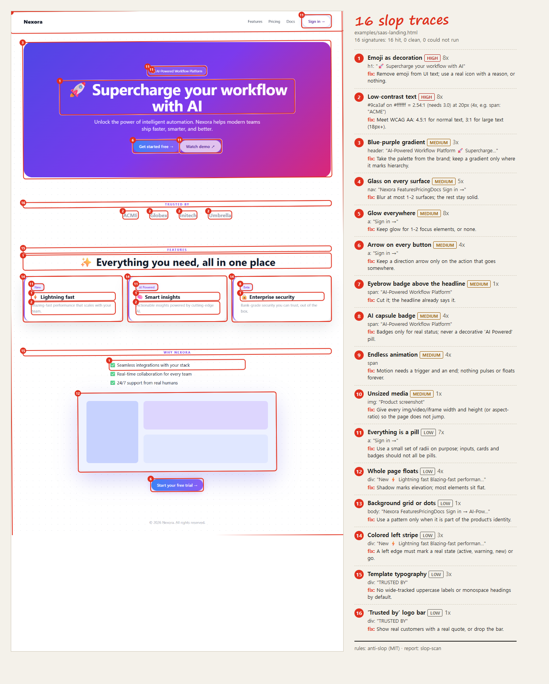
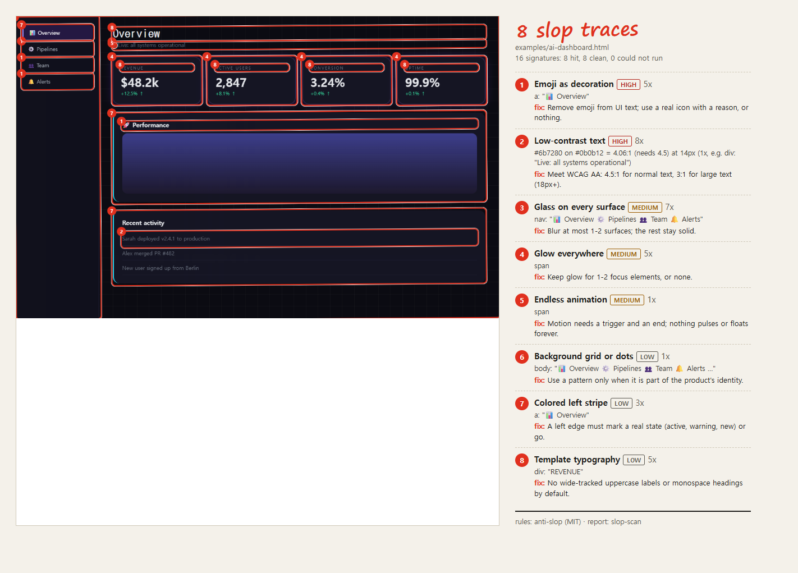
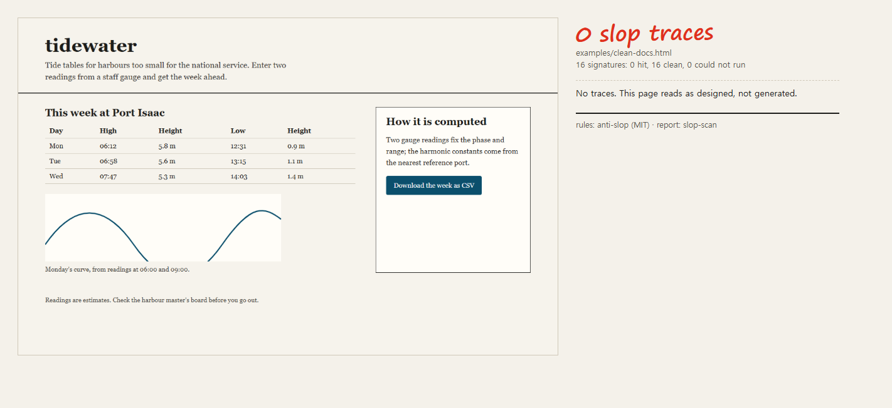

<div align="center">

# slop-scan

**See every AI-slop tell on your page, circled in red pen, with the fix next to it.**

[anti-slop](https://github.com/miqdadbadjuber/anti-slop) tells your agent what generated UI looks like. slop-scan opens the page in a real browser and finds those tells for you, the way a malware scanner looks for known traces.

 

Works with **Claude Code** and **Codex**.

</div>



## Quick start
```bash
git clone https://github.com/Dodai0419/slop-scan && cd slop-scan
python slopscan.py examples/saas-landing.html -o out      # or any http(s) URL
```
```
slop traces: 16 of 16 signatures
   1. AS-07 [high] Emoji as decoration x8: h1: "🚀 Supercharge your workflow with AI"
   2. AS-15 [high] Low-contrast text x8: #9ca3af on #ffffff = 2.54:1 (needs 3.0) at 20px (4x, e.g. span: "ACME")
   3. AS-01 [medium] Blue-purple gradient x3: header: "AI-Powered Workflow Platform 🚀 Supercharge…"
   ...
wrote out\slop-report.png, report.md, report.html, traces.json in 15.1s
```
You need Python 3.8+ and Chrome, Chromium or Edge. Nothing to install: standard library only. The browser runs headless with a throwaway profile, so your own browser is not touched.

## Gallery

| Input | What slop-scan found |
|---|---|
| `examples/saas-landing.html`: a landing page in the style an agent writes when nobody steers it | **16 of 16** tells: emoji headings, gray-on-white text at 2.54:1, blue-to-pink hero, glass nav and cards, glow on every button, an arrow on every button, eyebrow pill above the h1, "AI Powered" capsules, pulsing dot, unsized screenshot, "Trusted by" bar |
| `examples/ai-dashboard.html`: a dark "ops" dashboard | **8 of 16**: emoji nav, `#6b7280` on `#0b0b12` at 4.06:1, 7 blurred surfaces, glowing live dot that blinks forever, graph-paper background, left stripes, wide uppercase stat labels |
| `examples/clean-docs.html`: a hand-made page for a tide table | **0 of 16**: 28 text elements checked, all pass WCAG AA |

**AI dashboard**



**Clean page (no traces)**



Every run writes four files:

| File | For |
|---|---|
| `slop-report.png` | the picture above: your page with numbered red boxes, and the list of tells with fixes |
| `report.md` | the same list in Markdown plus a coverage table, ready to paste into a PR |
| `report.html` | the picture as a page (links `page.png`) |
| `traces.json` | everything as data: signature id, tier, count, evidence, boxes, coverage |

## The problem
- Agents produce the same landing page every time: purple gradient, glass cards, 🚀 in the headline. People notice, and the product looks generated.
- anti-slop's rules fix this when the agent reads them, but nothing checks the page that comes out. Reading a 29 KB rule file is not the same as looking at the result.
- Contrast is the one check anti-slop automates, and its script checks one color pair per call. Nobody runs it on every text element of a page.

## The solution
| Idea | Fixes |
|------|-------|
| **Render first, then judge** | The page is measured in a real browser (computed styles, real boxes, running animations), so the scan sees what a visitor sees, not what the source says. |
| **Signatures, like a malware scanner** | 16 tells from anti-slop are written as signatures `AS-01`..`AS-16` with a tier (high/medium/low) and evidence for every hit, as Zero-Breach-Toolkit does for spyware traces. |
| **Coverage, not silence** | Every check says `hit`, `clean` or `could-not-run` and why (for example "6 text elements over images or gradients not checked"). A clean report means it looked. |
| **The fix is printed next to the tell** | Each trace carries anti-slop's fix in one line, so the agent can act on the report without loading the whole rule file. |
| **Contrast on every text element** | Same formula and thresholds as anti-slop's `contrast-check.py` (unrounded ratio, 4.5:1 normal, 3:1 for 18px+), run on every text element over a plain background in one pass. |

## Signatures

| Id | Tell | Tier | Hit when |
|---|---|---|---|
| AS-01 | Blue-purple gradient | medium | a gradient has 2+ saturated stops between cyan and pink |
| AS-02 | Glass on every surface | medium | more than 2 elements use `backdrop-filter: blur` |
| AS-03 | Everything is a pill | low | 80%+ of 4+ buttons, inputs and badges are fully rounded |
| AS-04 | Whole page floats | low | 4+ elements have a soft drop shadow with 20px+ blur |
| AS-05 | Glow everywhere | medium | 3+ elements have a colored zero-offset shadow |
| AS-06 | Background grid or dots | low | a large element has a repeating or tiled (64px or less) gradient |
| AS-07 | Emoji as decoration | high | any text element contains an emoji (©, ®, ™ and arrows excluded) |
| AS-08 | Arrow on every button | medium | 60%+ of 3+ buttons end in an arrow |
| AS-09 | Colored left stripe | low | 2+ elements have a 2-8px colored left border and no right border |
| AS-10 | Eyebrow badge above the headline | medium | the element right before the h1 is a short pill |
| AS-11 | AI capsule badge | medium | a pill says "New", "Beta" or "AI Powered" |
| AS-12 | Template typography | low | 2+ wide-tracked uppercase labels, or a monospace h1-h3 |
| AS-13 | Endless animation | medium | any visible element animates with infinite iterations |
| AS-14 | Unsized media | medium | an img/video/iframe has no width+height and no aspect-ratio |
| AS-15 | Low-contrast text | high | WCAG AA fails (4.5:1, or 3:1 at 18px+) |
| AS-16 | "Trusted by" logo bar | low | a heading starts with "Trusted by", "Loved by", "As seen on" |

anti-slop's UI skill lists 41 tells; the other 25 (for example "copy-paste feature cards" or "charts without a question") need judgment, so slop-scan leaves them to the agent.

## Use in CI
```bash
python slopscan.py http://localhost:3000 -o slop --fail-on medium   # exit 1 if any medium or high trace
python slopscan.py page.html --json                                   # traces as JSON on stdout
```

## Use with Claude Code
```bash
/plugin marketplace add Dodai0419/slop-scan
/plugin install slop-scan@slop-scan
```
Then ask: "scan the landing page for AI slop and fix what you find". The skill runs the scan, reads `report.md`, fixes the tells, and scans again.

## Use with Codex (ChatGPT)
```bash
git clone https://github.com/Dodai0419/slop-scan && cp -r slop-scan/skills/* ~/.codex/skills/
```
Or copy `AGENTS.md` into your project root.

## Benchmarks
Windows 11, Python 3.11.1, Chrome stable, a busy machine (many other Chrome processes). `python bench/bench.py 3`, median of 3 runs:

| Example | Traces | Text elements contrast-checked | Scan only | Full CLI (scan + 2 screenshots) |
|---|---|---|---|---|
| saas-landing | 16 / 16 | 26 (6 over gradients skipped) | 4.5 s | 16.4 s |
| ai-dashboard | 8 / 16 | 23 | 2.4 s | 12.6 s |
| clean-docs | 0 / 16 | 28 | 5.7 s | 15.0 s |

Most of the time is Chrome starting and closing (twice per CLI run). Times on this machine moved by up to 2x between runs.

Compared with anti-slop (commit 3005235):

| | anti-slop | slop-scan |
|---|---|---|
| checks that run as code | 1 (contrast, one color pair per call) | 16 signatures, every element on the page |
| contrast pairs per call | 1 | 23-28 on the examples |
| rule text the agent loads for UI review | 45,584 bytes (`antislop-ui` + `antislop-human` SKILL.md) | the report: `report.md` is 1,312 / 3,329 / 5,547 bytes on the three examples |
| executable code | 289 lines (`contrast-check.py` 168 + `contrast-mcp.py` 121) | 455 lines (`slopscan.py`) |
| dependencies | Python (contrast), Node for the plugin launcher | Python standard library + a Chromium browser |

Contrast results match anti-slop: `tests/test_slopscan.py` recomputes all 9 rows of anti-slop's own reference table (ratio to 2 decimals and both verdicts), including the `#777777 on #070707` case that shows 4.50 and still fails.

## Known limits
- Text over a background image or gradient is not contrast-checked (it is counted as "not checked" in the coverage note).
- Pages behind a login, or that need clicks to show content, are scanned as they first load.
- The thresholds are heuristics. A brand that really is purple will still get AS-01; the tier and the evidence are there so you can decide.

## Inspired by
- [miqdadbadjuber/anti-slop](https://github.com/miqdadbadjuber/anti-slop) (MIT): the tells, their fixes, and the contrast rule and reference table.
- [interplains/Zero-Breach-Toolkit](https://github.com/interplains/Zero-Breach-Toolkit) (Apache-2.0): the report shape, meaning signatures with tiers, evidence per hit, and a ran / could-not-run state for every check. No code copied.

## Roadmap
- [ ] Sample real pixels under text so contrast over gradients is checked too
- [ ] `--mobile` viewport and a side-by-side desktop/mobile report
- [ ] Text tells from `antislop-copywriting` ("Unlock the power of", "seamless")

## License
MIT. See `LICENSE` and `NOTICE`.
